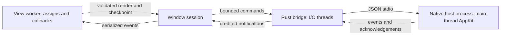

# LiveSidestep

Elixir-owned views in native AppKit windows. A separate Rust host runs the UI;
Elixir callbacks use Phoenix assigns and a small native template language.
There is no browser, HTML renderer, or LiveView transport.

Linux uses [Sidestep](https://github.com/bitemyapp/sidestep), pinned to
[`626422b1fa52fc14af13976c5c90b4efd657b1d7`](https://github.com/bitemyapp/sidestep/tree/626422b1fa52fc14af13976c5c90b4efd657b1d7).
macOS selects system AppKit. Sidestep itself is early-stage: the verified target
here is Linux x64 on Wayland, not a blanket cross-platform production guarantee.

## Build and run

Build prerequisites: Elixir 1.20 / OTP 28, Rust 1.97 with Cargo, a C toolchain,
`pkg-config`, and `curl`. Initial compilation needs network access for locked
Cargo dependencies and checksum-verified Objective-C bindings.

On Debian/Ubuntu:

```sh
sudo apt-get install build-essential pkg-config curl libfontconfig1-dev fonts-dejavu-core libwayland-client0
mix deps.get
mix compile
iex -S mix run
```

In IEx, from a Wayland desktop session:

```elixir
{:ok, session} = LiveSidestep.open(LiveSidestep.Demo)
```

The demo includes a counter, a five-second CPU-bound callback, revisioned text
editing, keyed editor insertion/removal/reordering, and worker recovery. Type
while the CPU callback runs; its work must not block the native editor.

For a sibling application, add a source dependency:

```elixir
{:live_sidestep, path: "../live_sidestep"}
```

Mix builds and installs both `priv/native/live_sidestep_native.so` and
`priv/native/live_sidestep_host`. On macOS the generated NIF is a dylib installed
under the `.so` name expected by the loader. Generated bindings and Cargo outputs
stay under `_build`; they are not vendored build artifacts. The unmodified,
checksum-pinned binding generator and its licenses are in `native/objc2-overlay`.
No separately installed Sidestep checkout is required.

## Define a view

```elixir
defmodule MyApp.Window do
  use LiveSidestep.View

  @impl true
  def mount(_params, _session, socket) do
    {:ok, assign(socket, count: 0, draft: "", draft_revision: 0)}
  end

  @impl true
  def render(assigns) do
    ~V"""
    <column id="window" gap={12}>
      <text>Count: {@count}</text>
      <button id="increment" phx-click="increment">Increment</button>
      <input id="draft" value={@draft} edit_revision={@draft_revision}
        placeholder="Type here" phx-change="edit" />
    </column>
    """
  end

  @impl true
  def handle_event("increment", _params, socket) do
    {:noreply, update(socket, :count, &(&1 + 1))}
  end

  def handle_event("edit", %{"value" => value, "edit_revision" => revision}, socket) do
    {:noreply, assign(socket, draft: value, draft_revision: revision)}
  end
end

{:ok, session} = LiveSidestep.open(MyApp.Window, title: "My native window")
```

`use LiveSidestep.View` imports `assign/2,3`, `update/3`, the `LiveSidestep.UI`
constructors, and `~V`. `render/1` returns exactly one native node. A function-built
render is equivalent to a template; for example, `column([text("Hello")])`.

Templates support `column`, `row`, `list`, `text`, `button`, and `input`, Elixir
brace expressions, assigns, `:if`, and a single keyed `:for` generator. Repeated
nodes require an explicit, globally unique application key:

```elixir
~V"""
<list id="rows" gap={8}>
  <text id={"row-#{row.id}"} :for={row <- @rows}>{row.label}</text>
</list>
"""
```

This is not HEEx. HTML tags, arbitrary properties, components, slots, and other
directives are rejected. `handle_info/2` may return `{:noreply, socket}` for
application messages. Unknown messages/events and unsupported callback return
shapes fail the worker rather than silently dropping application actions.

## Native vocabulary and identity

| Kind | Properties, besides `id` |
| --- | --- |
| `column`, `row`, `list` | `gap` (integer, 0–128) |
| `text` | `text` |
| `button` | `text`, `phx-click`, `incarnation`, scalar `phx-value-*` |
| `input` | `value`, `placeholder`, `phx-change`, `edit_revision`, `incarnation`, scalar `phx-value-*` |

Text uses native wrapping labels; buttons are `NSButton` controls and inputs are
single-line `NSTextField` controls with the native field editor. Interactive
controls accept activating clicks. Containers use native views with Rust layout;
rows wrap and vertically center children on each line, columns/lists stack, and
the window has a native vertical scroll view.
`list` is not a virtualized table. There is no CSS or arbitrary HTML fallback.

The function constructors accept atom or string attribute names. Their `event:`
option aliases `phx-click` on buttons and `phx-change` on inputs; conflicting or
unknown options raise. Function `text/2` preserves whitespace, while literal
text/button template content is joined and trimmed. Set the `text` property to
preserve surrounding template whitespace.

Static nodes may omit IDs; their fallback identity is `parent_id/index`. Use
explicit stable keys for insertion, removal, and reordering. The same ID and kind
retain the actual native object. For a logically new button/input reusing an ID,
change its unsigned `incarnation`; stale interactions from its predecessor are
then rejected. Reordering surviving controls does not remove/re-add them.

### Text edits and acknowledgements

A change event contains the complete UTF-8 `"value"` and an integer
`"edit_revision"`. Store **both**, then render the revision back on the input as
shown above. Scalar `phx-value-*` properties arrive with that prefix removed;
native `value` and `edit_revision` are authoritative for those parameter names.

An old render must not overwrite a newer native draft. Equal acknowledgements
leave selection and composition untouched; an accepted transformed value maps
selection using UTF-16 boundaries. Transformations during marked-text composition
are deferred until composition ends. A remount retains and, when necessary,
re-publishes an unacknowledged native draft. A failed edit callback is retired
without committing its assigns or replaying its effects; a newer full draft can
still be delivered.

Real compositor typing, selection, reorder, and recovery are covered by the
Wayland acceptance suite. Composition/UTF-16 reconciliation is covered by Rust
state tests. A real IME/input-method compositor session has **not** been exercised;
that remains a platform acceptance limit, not a claim of complete IME support.

## Ownership and failure semantics



- `open/2` returns before mount/render completes. The window is revealed after
  its first valid tree, with initial configuration already applied. Monitor the
  returned session PID for asynchronous startup failures.
- Only successful callbacks followed by a valid, encodable render commit assigns.
  A worker failure remounts, then overlays the last checkpoint on mount defaults.
  Process resources and socket-private state must be recreated by `mount/3`.
- Checkpoints are in-memory presentation state, **not durable storage or a
  transaction**. External effects already performed before a failure cannot be
  undone. The failed in-flight callback is not replayed.
- At most three worker restarts are allowed in a rolling five-second interval.
  A fourth stops that session. Native host failure and user window close also
  stop it permanently; temporary supervisor children do not resurrect windows.
- Closing or killing a session stops its worker and reaps its host. A host crash
  is isolated from the BEAM; the bridge itself is a NIF, not an OS sandbox.
- One publication is in flight, based on the last acknowledged tree. Busy
  submissions retain the desired tree for retry; a resync uses a full snapshot.
  Missing application acknowledgement for five seconds closes the session.
- One semantic callback is in flight. Pending actions are FIFO; adjacent changes
  for the same control may coalesce, but click/change barriers are preserved.
  Semantic overload stops the session explicitly instead of silently dropping
  clicks. Native bridge notifications require mailbox credits.

Only Phoenix assign management and callback shapes are reused. The socket is a
hand-built `Phoenix.LiveView.Socket`: there is no endpoint, router, channel,
LiveView diff engine, navigation, streams, flash, components, or push APIs. The
compatibility boundary is isolated in `LiveSidestep.PhoenixAdapter`.

## Public session API

- `open(view, options \\ [])` → `{:ok, session}` or a startup error.
- `view_pid(session)` → the current callback worker without waiting on its work.
- `restart_view(session)` → `:ok`, retaining the window and valid checkpoint.
- `inspect_native(session, timeout \\ 5000)` → `{:ok, map}` or `{:error, reason}`.
- `close(session)` → `:ok`, closing the host and worker.

Options: `params:` and `session:` maps, `name:` (ordinary GenServer naming),
`host:` (a trusted executable implementing this protocol), `title:` (default
`"LiveSidestep"`), and `width:`/`height:` (default 960/720). Invalid options or
view modules raise before opening resources. As with ordinary GenServer APIs,
calls against an already terminated session exit.

Inspections report actual native control identities, frames, applied generation
and revision, host PID, and editor value, edit/ack revision, UTF-16 selection,
marked range, and focus. Frames use top-left content coordinates, accounting for
native scrolling. `frames` counts **native run-loop ticks**, not presented frames.
An applied tree or inspection is not a compositor presentation fence. Desktop
automation must account for compositor placement/presentation transactions.

Inspection errors include `:not_ready`, `:busy`, `:timeout`, `:closed`, and native
errors. Oversized diagnostic output returns an explicit inspection error rather
than an oversized frame. Pending callers are monitored and timed out; orderly
session shutdown replies `{:error, :closed}` to outstanding inspections.
Untrappable session death can exit the GenServer call instead.

### Enforced boundaries

| Boundary | Limit |
| --- | ---: |
| One UTF-8 JSON frame, excluding newline | 1,048,576 bytes |
| Nodes / root-counted depth | 4,096 / 64 |
| IDs, event names, property names, window title | 1,024 UTF-8 bytes |
| Text, values, placeholders, string event parameters | 65,536 UTF-8 bytes |
| Initial width / height | 200–8,192 each |
| Bridge and host command queues | 8 each |
| Host output queue / bridge notification credits | 64 / 64 |
| Pending semantic events / outstanding inspections | 64 / 64 |

Strings reject NUL and invalid UTF-8. Counters are unsigned 64-bit; generations
and applied revisions are positive. Event parameters are JSON scalars, with exact
integers in `-2^63..2^64-1`, never nested arrays/maps. Validation also covers
manually constructed structs and wire trees. Invalid patches are atomic: no
partial topology mutation reaches controls. Snapshots, patches, configuration,
inspection, and shutdown use strict, bounded newline-delimited JSON protocol v1.

## Validation and releases

```sh
mix deps.get
mix ci
sudo apt-get install sway grim wtype
scripts/wayland-check
mix docs --warnings-as-errors
mix hex.build
MIX_ENV=prod mix release
```

`mix ci` includes warning-free Elixir compilation, both formatters, native Clippy
and Rust tests, ExUnit, strict Credo, Dialyzer, zero-clone checks, and architecture/
smell checks. Linux integration tests use the real Sidestep null backend for
native identity, topology inversion, recovery, slow mount, and process cleanup;
that backend is not visual or compositor proof.

`scripts/wayland-check` creates a private headless Sway instance, real persistent
virtual input devices, and fixed-origin windows. It exercises native clicks,
typing while a callback burns CPU for five seconds, selection/keyed identity,
failed-edit recovery, and compositor-driven window close. It never calls native
test-event injection APIs. A normal Wayland desktop and `grim` can be used for
visual inspection of the demo. CI runs Linux x64; macOS, X11, and Windows are not
validated by these runs. X11 and Windows are not supported targets here.

Build releases on the deployment OS/architecture. The Mix compiler installs the
host and NIF into the application `priv` directory so a release does not need the
source checkout, Cargo, a repository-relative working directory, or a separate
host installation at runtime. The deployment still needs the appropriate native
OS libraries, fonts, and Wayland session (Linux) or AppKit environment (macOS).
The Hex artifact is a **source package**, not a matrix of prebuilt native binaries.

MIT license for this library. The vendored binding generator retains its upstream
MIT/Apache-2.0 notices and the objc2 notice; pinned dependencies retain their own
licenses. See `LICENSE` and `native/objc2-overlay/LICENSE*`.
